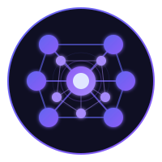

<p align="center">
  
</p>

<h1 align="center">Engram</h1>

<p align="center"><strong>Git-aware session memory for coding agents.</strong></p>

<p align="center">
  <a href="https://crates.io/crates/engram_mcp"></a>
  <a href="https://github.com/edg-l/engram-mcp/actions/workflows/ci.yml"></a>
  <a href="https://github.com/edg-l/engram-mcp/actions/workflows/release.yml"></a>
</p>

Engram is an [MCP](https://modelcontextprotocol.io/) server that gives a coding agent memory across sessions. At the end of a session the agent writes a handoff: what it decided, what blocks it, what it tried and abandoned. The next session on that branch starts from it, with the project's open todos alongside.

Everything stays on your machine: one SQLite file and a small local embedding model. Nothing is sent to a cloud service, and storing a memory never calls an LLM.

## A session, resumed

```console
$ engram-cli handoff resume
Branch: feat/auth
Latest handoff: mem_a5b0…
Chain (2 handoffs, oldest to newest):
  mem_e8cc…
  mem_a5b0…

Open todos (3 total):
  - [ ] Rotate the signing key before the 2.0 tag (mem_65e6…)
  ...

Open blockers:
  - Staging has no OAuth client for the new callback URL

Top sections:
─────────────────────────────────────────
[mem_a5b0…] tried (score: 0.94)
Refreshing tokens in middleware: every request raced the refresh and logged users out
─────────────────────────────────────────
...
```

An agent gets the same thing from the `handoff_resume` tool, or from the `/mcp__engram__resume` prompt in Claude Code.

## Install

```bash
cargo install engram_mcp
claude mcp add -s user engram $(which engram)
```

This installs two binaries. `engram` is the MCP server, which your client starts. `engram-cli` is for you and for scripts. For Claude Desktop, the session hooks and the handoff skills, see [setup](docs/setup.md).

## What it does

- Handoffs are structured into sections and chained per git branch, so context from `feat/auth` does not leak into `fix/billing`.
- Todos live on a durable per-project list with an explicit done or dropped state, so finished work and forgotten work stay distinguishable.
- Facts, decisions, patterns and debug findings are searched with BM25 and embeddings combined. Near-duplicates merge on store.
- Old knowledge fades as newer knowledge about the same project arrives, not with the calendar. A project you leave for a year is as fresh as the day you left it.
- A memory can be superseded by a newer one, which retrieval then returns in its place. Deletions go to a trash you can restore from.
- Project ids come from the git remote, so the same repo is the same project on every machine. `engram-cli sync user@host` keeps two machines in step over plain `ssh`.

## Documentation

| | |
|---|---|
| [Setup](docs/setup.md) | Clients, hooks, skills, syncing two machines |
| [MCP tools](docs/tools.md) | Every tool, its arguments, project and branch scoping |
| [CLI](docs/cli.md) | `engram-cli` commands and `--json` output |
| [Configuration](docs/configuration.md) | Environment variables |
| [How it works](docs/how-it-works.md) | Retrieval, decay, dedup, handoff chains, sync rules, benchmark |
| [Compared to other tools](docs/comparison.md) | Mem0, mcp-memory-service, Zep, Letta |
| [Hooks](hooks/README.md) | Passive capture from Claude Code lifecycle events |
| [Changelog](CHANGELOG.md) | |

## Limits

Single user, single node, no auth: it is a local MCP server. Sync is pairwise between machines you can `ssh` into, and deletions do not sync.

## Development

```bash
cargo build --release
cargo test
cargo clippy --all-targets
cargo fmt --check
```

## License

[Apache-2.0](LICENSE)
